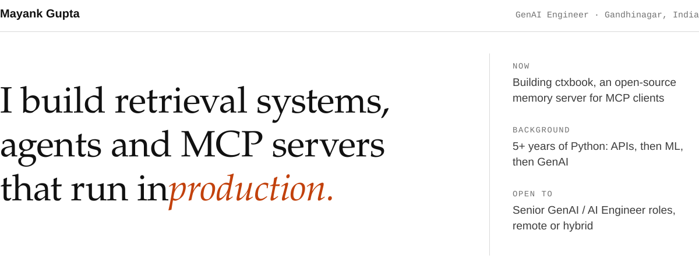
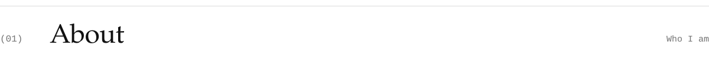
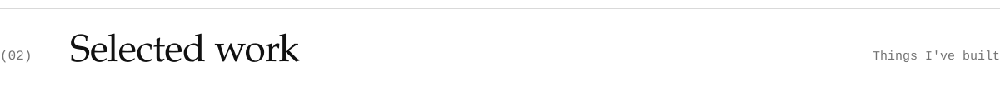
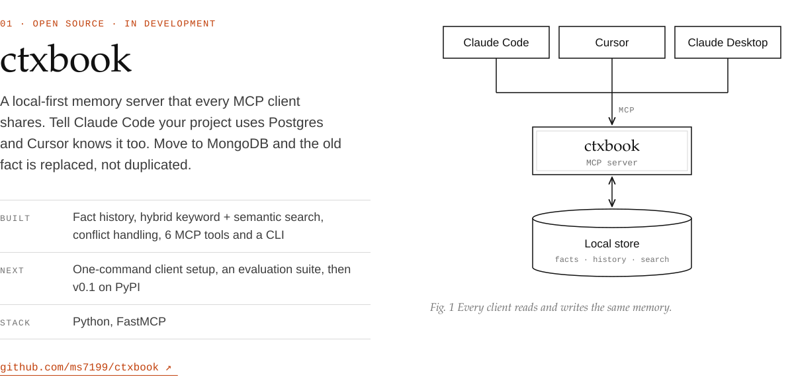
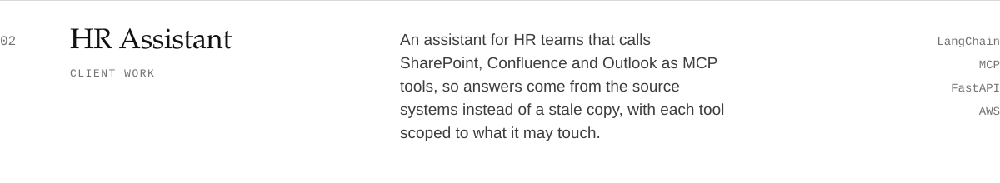
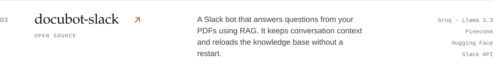
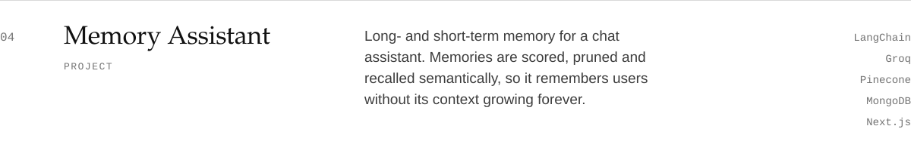
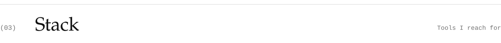
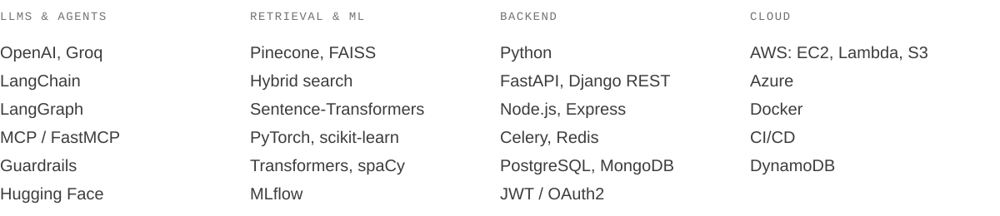
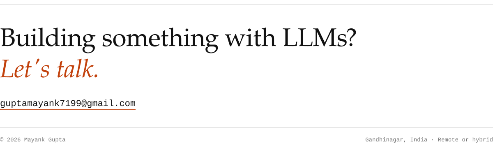

<picture>
  <source media="(prefers-color-scheme: dark)" srcset="assets/dark/hero.svg">
  
</picture>

<a href="#about">About</a> &nbsp;·&nbsp; <a href="#work">Work</a> &nbsp;·&nbsp; <a href="#stack">Stack</a> &nbsp;·&nbsp; <a href="#contact">Contact</a> &nbsp;&nbsp;&nbsp;/&nbsp;&nbsp;&nbsp; <a href="https://www.linkedin.com/in/guptamayank7199/">LinkedIn ↗</a> &nbsp;·&nbsp; <a href="mailto:guptamayank7199@gmail.com">Email ↗</a>

 

<picture>
  <source media="(prefers-color-scheme: dark)" srcset="assets/dark/section-about.svg">
  
</picture>

I'm a GenAI engineer with 5+ years of Python behind me: backend APIs first, then classical ML, and now LLM systems. Most of my recent work connects models to the places a company's knowledge actually lives, like SharePoint, Confluence, Outlook and Slack.

I also train developers, and I write on [LinkedIn](https://www.linkedin.com/in/guptamayank7199/) about what goes wrong when RAG meets real documents.

**How I work**

- **Measure retrieval before tuning prompts.** A small eval set decides whether a change actually helped.
- **Give agents the fewest permissions that work.** Validate tool inputs, and decide the failure path up front.
- **Keep the infrastructure boring.** FastAPI, Postgres, Docker, AWS: things the next engineer can run.

 

<picture>
  <source media="(prefers-color-scheme: dark)" srcset="assets/dark/section-work.svg">
  
</picture>

<a href="https://github.com/ms7199/ctxbook"><picture>
  <source media="(prefers-color-scheme: dark)" srcset="assets/dark/project-ctxbook.svg">
  
</picture></a>

<picture>
  <source media="(prefers-color-scheme: dark)" srcset="assets/dark/project-hr.svg">
  
</picture>
<a href="https://github.com/ms7199/docubot-slack"><picture>
  <source media="(prefers-color-scheme: dark)" srcset="assets/dark/project-docubot.svg">
  
</picture></a>
<picture>
  <source media="(prefers-color-scheme: dark)" srcset="assets/dark/project-memory.svg">
  
</picture>

  

<picture>
  <source media="(prefers-color-scheme: dark)" srcset="assets/dark/section-stack.svg">
  
</picture>

<picture>
  <source media="(prefers-color-scheme: dark)" srcset="assets/dark/stack.svg">
  
</picture>

I've also integrated SharePoint, Confluence, Outlook, Slack, Stripe, Razorpay, Twilio and SendGrid, and I work in React and Next.js when a project needs a frontend.

  

<a href="mailto:guptamayank7199@gmail.com"><picture>
  <source media="(prefers-color-scheme: dark)" srcset="assets/dark/contact.svg">
  
</picture></a>

<a href="https://www.linkedin.com/in/guptamayank7199/">LinkedIn</a> &nbsp;·&nbsp; <a href="mailto:guptamayank7199@gmail.com">Email</a> &nbsp;·&nbsp; <a href="https://stackoverflow.com/users/9546688/mayank-gupta">Stack Overflow</a> &nbsp;·&nbsp; <a href="https://x.com/msgupta_07">X</a> &nbsp;·&nbsp; <a href="https://github.com/ms7199">GitHub</a> &nbsp;&nbsp;&nbsp;/&nbsp;&nbsp;&nbsp; <a href="#top">Back to top ↑</a>

